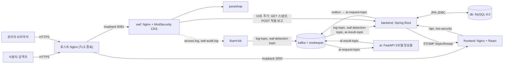

# 02. 아키텍처

이 문서는 DualGuard의 구성 요소와 데이터 흐름, 동기/비동기 경계, 단일 EC2 배포 구조, 로컬과 AWS의 차이, 자원 제약을 설명한다.

최종 확인: 2026/11/08 · 기준 파일: [compose.aws.yaml](../../compose.aws.yaml), [compose.yaml](../../compose.yaml)

## 1. 전체 구조

기존 그림 [ArchitecureImg.png](../images/ArchitecureImg.png)은 같은 흐름에 CI/CD(GitHub Actions → ECR → SSM)를 더해 보여 준다. 그 그림에는 호스트 Nginx와 블랙리스트 동기화 경로가 빠져 있다.

## 2. 구성 요소

EC2에서는 상시 9개 서비스와 일회성 초기화 컨테이너 1개가 실행된다.

| 서비스 | 이미지·빌드 | 역할 | EC2 호스트 바인딩 |
| --- | --- | --- | --- |
| `db` | `mysql:8.0` | 로그·탐지·블랙리스트·outbox·알림·동기화 상태 저장 | 없음 |
| `zookeeper` | `cp-zookeeper:7.3.0` | Kafka 메타데이터 | 없음 |
| `kafka` | `cp-kafka:7.3.0` | 토픽 브로커(내부 `kafka:29092`) | 없음 |
| `backend` | ECR `security-backend:<SHA>` | REST API, Kafka 소비, 탐지 저장·요청 연결, outbox·알림 발행, WAF 동기화 API | `127.0.0.1:8080` |
| `frontend` | ECR `security-frontend:<SHA>` | React 정적 파일, `/api`·`/ws-security`를 backend로 프록시([nginx.conf](../../frontend/nginx.conf)) | `127.0.0.1:3000` |
| `ai` | ECR `security-ai:<SHA>` | `ai-request-topic` 소비, 규칙 게이트 + 3모델 판정, 결과 발행 | `127.0.0.1:8000` |
| `juiceshop` | `bkimminich/juice-shop` | 보호 대상 테스트 웹 서버 | 없음(내부 3000) |
| `waf` | `owasp/modsecurity-crs:nginx` | 리버스 프록시, CRS 탐지(`DetectionOnly`), 블랙리스트 IP 403, 블랙리스트 동기화 루프 | `127.0.0.1:8081` |
| `fluent-bit` | `fluent/fluent-bit:2.2` | WAF 로그 tail → Kafka 전송 | 없음 |
| `waf-blacklist-init` | `owasp/modsecurity-crs:nginx` | 블랙리스트 상태 볼륨 권한·빈 룰 파일 준비 후 종료 | 없음 |

Kafka 토픽과 소비 그룹은 다음과 같다. 상세는 [03 이벤트 파이프라인](03_event_pipeline.md)에 있다.

| 토픽 | 생산자 | 소비자(그룹) | 비고 |
| --- | --- | --- | --- |
| `log-topic` | Fluent Bit(access.log) | `LogKafkaConsumer`(`log-group`) | 실패 시 `log-topic.DLT` |
| `waf-detection-topic` | Fluent Bit(waf-audit.log + Lua 필터) | `WafDetectionConsumer`(`waf-detection-group`) | `WAF_CONSUMER_ENABLED`로 켬, 실패 시 `waf-detection-topic.DLT` |
| `ai-request-topic` | backend outbox 발행기 | AI(`ai-service-group`) | 파티션 2(`AiRequestTopicConfig`), 키 `logId` |
| `ai-result-topic` | AI | `AiResultConsumer`(`ai-result-group`) | 실패 시 `ai-result-topic.DLT` |

## 3. 데이터 흐름

1. **요청**: 사용자 → 호스트 Nginx → WAF → Juice Shop. WAF는 `$request_id`를 요청 ID로 쓰고 ModSecurity 거래 ID와 응답 헤더 `X-Request-ID`에도 같은 값을 넣는다.
2. **로그**: WAF access.log → Fluent Bit → `log-topic` → `LogService`가 `network_logs`에 저장한다. 같은 트랜잭션에서 AI 요청 outbox 행을 만든다.
3. **AI 탐지**: outbox 발행기가 커밋 직후 깨우기(주기 조회는 복구용)로 `ai-request-topic`에 보낸다. AI 결과는 `ai-result-topic` → `ThreatService`가 공격 판정만 저장한다.
4. **WAF 탐지**: waf-audit.log → Lua 필터로 탐지 필드 추출 → `waf-detection-topic` → `WafDetectionService`·`WafDetectionWriter`. 원본 로그보다 먼저 와도 보존한다.
5. **요청 연결·자동 차단**: `RequestCorrelationService`가 `request_id`별 잠금을 잡고 두 탐지를 연결한다. 둘 다 있고 IP가 같으면 `AutoBlacklistPolicyService`가 등록한다.
6. **알림**: 탐지 트랜잭션에 `request_alerts` 대기 행을 함께 저장하고, 커밋 뒤 `RequestAlertPublisher`가 STOMP `/topic/threats`로 보낸다.
7. **차단 동기화**: WAF의 [blacklist-sync.sh](../../waf/sync/blacklist-sync.sh)가 `GET /internal/waf/blacklist`로 스냅샷을 받아 룰을 교체·reload하고, `POST /internal/waf/sync-status`로 결과를 보고한다. 상세는 [05 WAF 동기화](05_waf_sync.md).

## 4. 동기/비동기 경계

| 구간 | 방식 | 실패 시 동작 | 근거 |
| --- | --- | --- | --- |
| 사용자 → WAF → Juice Shop | 동기 HTTP. CRS 판정은 응답을 막지 않고 블랙리스트 IP만 403 | — | [waf/README.md](../../waf/README.md) |
| 관리자 → frontend → backend REST | 동기 HTTP, 세션·CSRF | 401/403 | `config/SecurityConfig` |
| WAF 로그 → Fluent Bit → Kafka | 비동기. 0.1초 Flush, `acks=-1`, 파일 버퍼·읽기 위치를 볼륨에 보존 | 무제한 재시도 | [fluent-bit.conf](../../waf/fluent-bit.conf) |
| Kafka → backend 소비 | 비동기, 레코드 단위 ack | 1초 간격 2회 재시도 후 DLT. 형식 오류는 바로 DLT | `PipelineKafkaErrorConfig`, `WafKafkaConsumerConfig` |
| 로그 저장 → AI 요청 발행 | 같은 트랜잭션 outbox → 커밋 후 발행 | 실패 시 대기 유지·재시도. 선점 후 종료되면 리스 만료 뒤 재선점 | `AiRequestOutbox*`, [복구 검증](../testing/local/recovery-verification.md) |
| AI 소비·추론 | 비동기. 스레드 1개가 1건씩 판정 → 결과 전송·`flush()`, 자동 오프셋 커밋 | 처리 중 프로세스 종료 시 결과가 빠질 수 있음(정합성 후보) | [AI_new/main.py](../../AI_new/main.py), [단계 부하 계획](../testing/ec2/step-load-plan.md) 2절 |
| 탐지 저장 → 알림 | 같은 트랜잭션 대기 행 → 커밋 후 전송·재시도 | 커밋 전 발송 없음. 종단 간 exactly-once는 주장하지 않음 | `RequestAlert*` |
| WAF ↔ backend 블랙리스트 | 10초 주기 HTTP 조회·보고(토큰 인증) | 마지막 정상 룰 유지. 보고 60초 단절 시 상태 미확인 | `WafSyncController`, `WafSyncStatusService` |
| 보조 HTTP | AI `POST /predict`, backend `POST /api/v1/threats/detect` | 기본 파이프라인이 아님(보조·테스트용) | AI_new/main.py, [README.md](../../README.md) |

## 5. 배포 구조 (AWS)

EC2 t3.large(2 vCPU/8GiB, gp3 50GiB, Ubuntu 24.04 LTS, 서울 리전) 한 대에서 Compose 프로젝트 `security-platform-aws`로 실행한다. 개발·시연 환경이며 사용 후 중지한다.

| 외부 포트(보안 그룹) | 용도 | 허용 대상 |
| --- | --- | --- |
| 22 | SSH 관리 | 관리자 공인 IPv4/32 |
| 80 | 인증서 HTTP-01 검증, HTTPS 리다이렉트 | 전체 |
| 443 | HTTPS 대시보드·테스트 요청 | 접속을 허용한 사용자 공인 IPv4/32 |

- **호스트 Nginx(Git 밖)**: 대시보드 도메인의 443을 `127.0.0.1:3000`으로, Juice Shop용 호스트명을 `127.0.0.1:8081`(WAF)로 보낸다. Juice Shop 경로에서는 클라이언트가 보낸 `X-Forwarded-For`를 `$remote_addr`로 덮어쓴다.
- **실제 IP 복원**: WAF는 `SET_REAL_IP_FROM=${WAF_TRUSTED_PROXY}`(Docker 게이트웨이)가 보낸 `X-Forwarded-For`만 신뢰한다. 8081을 외부에 열면 IP 위조가 가능하므로 loopback 바인딩을 유지한다.
- **내부 포트**: backend·frontend·ai·waf는 loopback에만 바인딩하고 DB·Kafka·Zookeeper는 호스트 포트를 열지 않는다.
- **저장소**: 볼륨 `mysql-data`·`kafka-data`·`zookeeper-data`·`zookeeper-log`·`fluent-bit-state`·`waf-blacklist-state`, 바인드 `./waf/logs`. 새 DB는 첫 기동 때 [security-db-schema.sql](../db/security-db-schema.sql)만 자동 실행한다. `docs/db/`의 추가 SQL(`add-waf-detections`·`add-request-correlation`·`add-request-alerts`)은 자동 실행되지 않는다(CI는 스키마 뒤에 순서대로 적용). 상세는 [07 데이터베이스](07_database.md).
- **배포**: `deploy.yml`(수동 `workflow_dispatch`)이 앱 이미지 3개를 ECR에 git SHA 태그로 올리고, SSM으로 [deploy.sh](../../scripts/deploy.sh)를 실행한다. deploy.sh는 이미지를 받아 `up -d --no-build` 후 backend·AI·frontend 상태를 확인한다. 절차는 [AWS 배포](../operations/aws_deployment.md)·[CI/CD](../operations/cicd.md).

## 6. 로컬과 AWS 차이

| 항목 | 로컬 `compose.yaml` | AWS `compose.aws.yaml` |
| --- | --- | --- |
| 입구 | WAF를 `127.0.0.1:80`에 직접 HTTP로 노출, 대시보드 `localhost:3000` | 호스트 Nginx HTTPS → loopback 8081(WAF)·3000(프론트) |
| 실제 IP 복원 | 설정 없음 | `SET_REAL_IP_FROM`·`REAL_IP_HEADER` |
| 앱 이미지 | 로컬 빌드 `security-*:local`, 고정 `container_name` | ECR `security-*:<git SHA>`(값이 없으면 EC2 빌드 `:aws`) |
| DB | 기존 데이터 디렉터리 바인드(`MYSQL_DATA_DIR`), root 비밀번호만 설정 | 프로젝트 볼륨, 스키마 자동 초기화, 앱 전용 계정(`MYSQL_USER`) |
| Kafka·Zookeeper 저장소·네트워크 | 외부 볼륨·외부 네트워크 `security-net` 재사용 | 프로젝트 볼륨·기본 네트워크 자동 생성 |
| DB·Kafka 호스트 포트 | `127.0.0.1:3306`, `127.0.0.1:9092` | 열지 않음 |
| Kafka healthcheck | 15초 간격, retries 12 | 60초 간격, 기동 중 5초, 시작 유예 120초, retries 3 |
| 세션 쿠키 | `SESSION_COOKIE_SECURE=false` | `true`, `SERVER_FORWARD_HEADERS_STRATEGY=native` |
| 발행기 주기 | 코드 기본값(AI outbox 500ms, 알림 1,000ms) | 각 250ms. 커밋 직후 깨우기는 양쪽 모두 기본 켬 |
| AI 프로세스 | 이미지 기본(uvicorn workers 1) | `AI_UVICORN_WORKERS` 기본 1, `OMP_NUM_THREADS`·`MKL_NUM_THREADS` 1 |

두 파일을 섞어 실행하지 않는다. 로컬 절차는 [로컬 Compose](../operations/local_compose.md)를 따른다.

## 7. 자원 제약

| 항목 | 값 | 근거 |
| --- | --- | --- |
| CPU 크레딧 | unlimited(2026/11/05 사용자 콘솔 확인) | [EC2 목차](../testing/ec2/README.md) P0 |
| 유휴 서버 CPU | 0.42 → 0.28 vCPU(Kafka healthcheck 60초 간격 적용 후) | [트러블슈팅_7](<../testing/ec2/트러블슈팅_7(상세본).md>) |
| 부하 중 호스트 CPU 평균 | 5 RPS 47.1%(1회) · 11 RPS 73.4~75.2% · 13 RPS 80.7~82.0% | [단계 부하 계획](../testing/ec2/step-load-plan.md) 4-4·4-5절 |
| 13 RPS 구간별 p95 | 로그 수집 203.8ms · WAF 경로 239ms · AI 구간 1,880.8ms | 단계 부하 계획 4-5절 |
| AI 처리 비용 | 메시지당 AI CPU 약 45~50ms, 프로세스당 모델 약 630MiB | [트러블슈팅_8](<../testing/ec2/트러블슈팅_8(상세본).md>) 2부, compose.aws.yaml |
| 가용 메모리 최소 | 13 RPS 4.49GB(중단 기준 1GiB) | 트러블슈팅_8 2부 |

트러블슈팅_8 2부에서 `ai-request-topic` 파티션 2 + AI 프로세스 2로 소비를 병렬화했다. AI 구간 p95는 1,881 → 3,037ms(첫 회차 제외 1,782ms), 호스트 CPU는 81 → 88~98%였다. AI가 쓰는 CPU는 그대로였고, 서버 전체 CPU가 이미 묶여 병렬화가 처리량을 만들지 못했다. **이 서버의 제약은 2 vCPU 호스트 CPU다.** AI 프로세스 기본값은 1로 되돌렸고 파티션 2는 유지한다(파티션은 줄일 수 없고, 소비자 1개가 두 파티션을 모두 읽는다).

같은 사양에서 지연을 줄이려면 요청당 총 CPU를 줄이거나 CPU를 늘려야 한다. 측정 도구도 같은 CPU를 쓴다. 5 RPS에서 부하 중 호스트 CPU의 약 11%p를 실행기가 쓰고 있었다(트러블슈팅_8 1부).

## 결정 · 대안 · 근거

| 결정 | 검토한 대안 | 선택 근거 | 관련 문서·코드 |
| --- | --- | --- | --- |
| AI 분석은 Kafka 비동기 경로 | backend가 AI `POST /predict`를 동기 호출 | backend와 AI를 직접 결합하지 않고 웹 요청 경로 밖에서 처리한다. 실패 메시지는 재시도·DLT로 남긴다. HTTP 추론 API는 보조용으로만 둔다 | [AI_new/README.md](../../AI_new/README.md) 5장, [03 이벤트 파이프라인](03_event_pipeline.md) |
| AI 요청은 트랜잭션 outbox로 발행 | 로그 저장 직후 Kafka로 바로 전송 | 로컬 r15에서 커밋 전 AI 요청 발행과 결과 예외 삼킴으로 AI 완료가 119/121건이었다. outbox·예외 전파·재시도/DLT 보완 후 r16~r18에서 361/361건 완료 | [로컬 목차](../testing/local/README.md), [복구 검증](../testing/local/recovery-verification.md) |
| 단일 EC2 + Compose | AI 전용 인스턴스 분리 등 다중 호스트 배포 | 개발·시연 환경이고 월 6만 원 예산이다. AI 분리는 비용, Kafka 외부 리스너·보안 그룹·배포 경로 변경이 필요하고 같은 사양 비교가 깨져 제외했다 | [AWS 배포](../operations/aws_deployment.md), [트러블슈팅_8](<../testing/ec2/트러블슈팅_8(상세본).md>) 2부 대안 E |
| 로컬·AWS Compose 파일 분리 | 한 파일 + 프로필·오버라이드 | 로컬은 기존 DB 데이터·Kafka 볼륨·`security-net`을 재사용한다. AWS는 HTTPS 입구, loopback 바인딩, 실제 IP 복원, ECR 이미지, 운영 주기 설정이 다르다 | [compose.yaml](../../compose.yaml), [compose.aws.yaml](../../compose.aws.yaml) |
| 호스트 Nginx TLS 종료 + 컨테이너 loopback 바인딩 | 컨테이너 포트를 보안 그룹으로 직접 공개 | WAF 포트가 외부에 열리면 `X-Forwarded-For` 위조로 차단 IP를 속일 수 있다. 외부는 443·80만 연다 | compose.aws.yaml 주석, [08 보안](08_security.md) |
