# 03. 이벤트 파이프라인

WAF 로그와 탐지 이벤트가 Kafka·outbox·알림을 거쳐 DB와 대시보드에 닿는 비동기 경로를, 왜 그렇게 나눴는지와 함께 정리한다.

> 기준은 2026/11/08 `develop` 코드다. 측정 수치는 EC2 실험 결과이며 설계 의도와 구분해 적는다. 탐지 판정·상관관계·차단 정책은 [04_detection.md](04_detection.md), 블랙리스트를 WAF에 적용하는 계약은 [05_waf_sync.md](05_waf_sync.md), 전체 구성은 [02_architecture.md](02_architecture.md)를 본다.

## 1. 전체 흐름

```mermaid
flowchart LR
    W["WAF<br/>Nginx + ModSecurity"] -->|access.log| F["Fluent Bit<br/>Flush 0.1"]
    W -->|감사 로그| F
    F -->|log-topic| L["LogKafkaConsumer"]
    F -->|waf-detection-topic| D["WafDetectionConsumer"]
    L --> T1[("network_logs<br/>+ ai_request_outbox")]
    T1 -.->|커밋 직후 깨우기 · 주기 조회| P["AiRequestOutboxPublisher"]
    P -->|ai-request-topic| A["AI_new kafka_worker"]
    A -->|ai-result-topic| R["AiResultConsumer"]
    D --> T2[("detected_threats · waf_detections<br/>+ request_alerts")]
    R --> T2
    T2 -.->|커밋 직후 깨우기 · 주기 조회| N["RequestAlertPublisher"]
    N -->|STOMP /topic/threats| U["대시보드"]
```

설계 원칙은 세 가지다.

- **기본 AI 분석은 Kafka 비동기다.** AI_new의 HTTP `/predict`는 같은 판정 로직을 쓰는 보조 API이며 기본 경로가 아니다.
- **DB 커밋이 기준이다.** Kafka 발행과 WebSocket 전송은 커밋된 DB 행을 보고 나중에 수행한다. 커밋 전 발송이나 롤백된 데이터의 발송을 만들지 않는다.
- **각 단계는 "적어도 한 번" 시도하고 저장은 멱등으로 만든다.** 종단 간 exactly-once를 주장하지 않는다(§7).

## 2. 토픽·컨슈머 그룹

| 토픽 | 생산자 | 소비자 (그룹) | 리스너 컨테이너 팩토리 | 파티션 | 메시지 키 |
| --- | --- | --- | --- | --- | --- |
| `log-topic` | Fluent Bit `waf.access` 출력 | [LogKafkaConsumer] (`log-group`) | `kafkaListenerContainerFactory` | 1¹ | 지정 안 함 |
| `ai-request-topic` | [AiRequestProducer] (outbox 발행기가 호출) | AI_new `kafka_worker` (`ai-service-group`, kafka-python) | 해당 없음 (Python) | **2** ([AiRequestTopicConfig]) | logId |
| `ai-result-topic` | AI_new `kafka_worker` | [AiResultConsumer] (`ai-result-group`) | `kafkaListenerContainerFactory` | 1¹ | log_id |
| `waf-detection-topic` | Fluent Bit `waf.audit` 출력 + Lua 필터 | [WafDetectionConsumer] (`waf-detection-group`)² | `wafKafkaListenerContainerFactory` | 1¹ | 지정 안 함 |
| `log-topic.DLT`, `ai-result-topic.DLT` | `pipelineDltRecoverer` | 상시 소비자 없음 | — | 1, 보존 7일 | — |
| `waf-detection-topic.DLT` | WAF 전용 recoverer² | 상시 소비자 없음 | — | 1 (보존 설정 없음) | — |

¹ 코드에 `NewTopic` 선언이 없어 브로커 자동 생성으로 만들어진다. EC2에서 파티션 1개로 관측했다([트러블슈팅_8] 1부).
² `app.kafka.waf.enabled`(환경 변수 `WAF_CONSUMER_ENABLED`, 기본 `false`)가 `true`일 때만 소비자·팩토리·DLT 선언이 생성된다.

- 브로커는 1대다. 모든 선언이 `replicas(1)`이고 `KAFKA_OFFSETS_TOPIC_REPLICATION_FACTOR`도 1이라 복제 보호는 없다.
- Spring 리스너는 concurrency를 설정하지 않아 리스너마다 소비자 1개로 동작한다.
- 프로듀서([KafkaProducerConfig])는 `acks=all`, idempotence 사용, `max.block.ms` 5초, delivery timeout 15초, request timeout 10초, `linger.ms` 0이다.
- `ai-service-group`에는 AI_new 서버만 붙인다. 다른 모델 서버가 같은 그룹에 들어오면 요청이 서버별로 나뉜다([AI_new README] 5장).

### 2.1 `ai-request-topic` 파티션 2 · AI 프로세스 1

- 파티션 2는 [AiRequestTopicConfig]가 선언하고 기동 시 KafkaAdmin이 맞춘다. 키가 logId라 두 파티션에 고르게 나뉘며 요청 간 순서는 필요 없다.
- AI 프로세스 수는 [compose.aws.yaml]의 `--workers ${AI_UVICORN_WORKERS:-1}`이다. 프로세스마다 모델(약 630MiB)과 Kafka 소비자 스레드를 하나씩 띄우고, 추론 스레드는 `OMP_NUM_THREADS`·`MKL_NUM_THREADS`=1로 고정한다. 로컬 이미지도 `--workers 1`이다.
- 2026/11/08 EC2에서 프로세스 2개를 13 RPS로 검증했다. 메시지 4,868건이 두 파티션에 49:51로 나뉘었지만 AI 구간 p95는 1,881 → 3,037ms(첫 회차 제외 1,782ms), 호스트 CPU는 약 81% → 88~98%였다. 병목은 소비자 수가 아니라 2 vCPU 서버의 CPU였다.
- 그래서 프로세스 기본값을 1로 되돌렸다(PR #116). 파티션은 줄일 수 없고 소비자 하나가 두 파티션을 모두 읽으므로 2를 유지한다. 선언을 1로 바꾸면 KafkaAdmin이 기동할 때마다 불일치를 기록한다. 근거는 [트러블슈팅_8] 2부다.

## 3. 재시도와 DLT

| 항목 | 로그·AI 결과 | WAF 탐지 |
| --- | --- | --- |
| 설정 | [KafkaConsumerConfig] + [PipelineKafkaErrorConfig] | [WafKafkaConsumerConfig] |
| 오프셋 커밋 | 자동 커밋 끔, `AckMode.RECORD` | 같음 |
| 재시도 | `FixedBackOff(1000ms, 2)`: 최초 1회 + 1초 간격 2회 | 같음 |
| 재시도 없이 DLT | `InvalidAiResultException`, `JsonProcessingException` | `InvalidWafEventException` |
| DLT 대상 | 원본 토픽에 따라 `log-topic.DLT`·`ai-result-topic.DLT`. 다른 토픽은 예외 | `waf-detection-topic.DLT` |
| DLT 전송 실패 | `setFailIfSendResultIsError(true)`로 복구 성공으로 보지 않고 다시 처리 | 같음 |
| 실패 로그 | 토픽·파티션·오프셋·시도 횟수·예외 클래스만. 원문은 남기지 않음 | 예외 메시지에 원문을 붙이지 않음 |

- 컨슈머는 파싱·검증 후 서비스만 호출한다. 업무 예외를 잡아서 끝내지 않고 컨테이너로 전달해야 재시도·DLT가 동작한다.
- `AiLogNotReadyException`(AI 결과가 가리키는 로그가 아직 없음)은 재시도 대상이다. 정상 경로에서는 outbox가 로그 커밋 뒤에 발행하므로 드물다.
- DLT는 자동으로 재처리하지 않는다. [kafka_replay.py]가 `log-topic.DLT`·`ai-result-topic.DLT`를 원래 토픽으로 되돌리는 수동 도구(list/replay)다. WAF DLT는 대상이 아니다.
- AI_new 쪽에는 재시도·DLT가 없다. JSON이 아닌 메시지는 건너뛰고, 추론·전송 실패는 로그만 남기고 다음 메시지로 넘어간다([AI_new main.py]). 정상 결과로 위장하지 않지만 해당 로그의 AI 판정은 비게 된다.

## 4. AI 요청 outbox

로그 저장(DB)과 Kafka 발행은 하나의 트랜잭션으로 묶을 수 없다. 트랜잭션 안에서 보내면 롤백된 로그의 요청이 나가고, 커밋 뒤 바로 보내면 그 사이 프로세스가 죽을 때 요청이 사라진다. 그래서 로그와 같은 트랜잭션에 발행 대기 행을 저장하고, 별도 발행기가 커밋된 행만 보낸다.

1. [LogService] `processRawLog`(READ_COMMITTED)가 새 `LogEntry`를 저장하고 [AiRequestOutboxService] `enqueue`를 부른다. `enqueue`는 `MANDATORY`라 로그 저장 트랜잭션 없이는 실패한다.
2. [AiRequestOutboxRepository]가 `ai_request_outbox`에 `PENDING`, `attempts=0`, `available_at=지금`으로 넣는다. PK가 `log_id`라 로그 하나당 작업 하나다.
3. [AiRequestOutboxPublisher]가 `claimNext`(REQUIRES_NEW, READ_COMMITTED)로 1건을 `FOR UPDATE SKIP LOCKED` 선점한다. `IN_FLIGHT`, UUID `lease_token`, `attempts+1`, `available_at=지금+60초`(선점 만료)로 바꾸고 바로 커밋한다.
4. DB 트랜잭션 밖에서 logId를 키로 전송하고 Kafka ACK를 최대 20초 기다린다.
5. 성공하면 `markSent`가 `lease_token`이 일치할 때만 `SENT`·`published_at`을 기록한다. 실패하면 `retry`가 `PENDING`으로 되돌리고 `min(attempts, 12) × 5초`(5 → 최대 60초) 뒤로 예약한다. `last_error_code`에는 예외 클래스 이름(100자 이내)만 남긴다. 인터럽트되면 그대로 두고 선점 만료 뒤 복구한다.
6. [AiRequestOutboxDispatcher]는 `aiRequestOutboxScheduler`(스레드 1개)에서 고정 지연으로 돌며 한 번에 최대 20건을 처리한다. 대기 행이 없거나 발행이 실패하면 이번 회차를 끝낸다. 실패 행을 삭제하거나 성공으로 처리하지 않는다.

| `processRawLog` 입력 형식 | 저장·enqueue |
| --- | --- |
| WAF access JSON(`remote_addr`·`method`·`path`, 운영 경로) | 같은 `request_id`의 로그가 이미 있으면 연결만 확인하고 끝낸다(enqueue 없음). 없으면 저장 후 항상 enqueue |
| `{"log": "..."}` Nginx 텍스트(테스트) | 정규식이 맞고 블랙리스트에 없는 IP만 저장·enqueue |
| `method`·`url_path` JSON(개발 도구 테스트) | 저장 후 enqueue |
| 그 밖 | 경고 로그만 남기고 무시 |

- `AI_OUTBOX_ENABLED`(`app.ai-outbox.enabled`)는 발행기 빈만 켜고 끈다. enqueue는 이 값과 무관하게 항상 수행하므로, 끄면 행이 `PENDING`으로 쌓인다.
- 저장소는 JPA가 아니라 `JdbcTemplate`이다. `ddl-auto: validate`가 이 테이블의 누락을 잡지 못하므로 DB를 준비할 때 [security-db-schema.sql](../db/security-db-schema.sql) 또는 기존 DB용 [add-ai-request-outbox.sql](../db/add-ai-request-outbox.sql) 적용 여부를 따로 확인한다([07_database.md](07_database.md)).
- `markSent` 자체가 실패하면 `IN_FLIGHT`가 남아 60초 뒤 다시 발행될 수 있다. 이때 생기는 AI 결과 중복은 §7에서 거른다.
- 측정: 주기 500 → 250ms로 outbox 생성 → 발행 완료 평균이 300.9 → 163.7ms([트러블슈팅_2]), 커밋 직후 깨우기로 160.4 → 35.8ms([트러블슈팅_5])가 됐다.

## 5. 커밋 직후 발행기 깨우기

발행기는 커밋 시점을 모른다. 그래서 주기 조회 대기(0~주기)가 그대로 지연이 됐다. 알림 1,000 → 250ms([트러블슈팅_1]), outbox 500 → 250ms([트러블슈팅_2])로 줄인 뒤에도 0~250ms 대기 모양이 남아, 커밋 직후 한 번 바로 실행하도록 바꿨다([트러블슈팅_5]).

- [AfterCommitDispatchTrigger] `requestAfterCommit()`은 저장 트랜잭션 안에서 호출하며 `TransactionSynchronization.afterCommit`에 실행을 등록한다. 롤백되면 실행하지 않는다. 트랜잭션 동기화가 없으면 아무것도 하지 않고 주기 조회에 맡긴다.
- `AtomicBoolean queued`로 아직 시작하지 않은 실행이 있으면 새로 예약하지 않는다. 실행이 시작될 때 표시를 먼저 지워 실행 중에 커밋된 행도 다음 실행에서 처리한다.
- 실행은 각 발행기가 쓰던 단일 스레드 스케줄러에 넣는다. 그래서 `@Scheduled` 주기 실행과 동시에 돌지 않는다. 예약·실행 실패는 로그만 남기고 예외를 던지지 않는다.
- 발행기 빈은 `ObjectProvider`로 실행 시점에 찾는다. 생성 시 순환 참조를 피하고, 발행기가 꺼진 환경에서는 아무것도 하지 않는다.

| 깨우기 | 호출 위치 | 실행기 ([OutboxSchedulingConfig]) | 끄기 설정 |
| --- | --- | --- | --- |
| [AiRequestOutboxWakeup] | `AiRequestOutboxService.enqueue` | `aiRequestOutboxScheduler` (스레드 1, `ai-outbox-`) | `app.ai-outbox.wakeup-enabled` / `APP_AIOUTBOX_WAKEUPENABLED` |
| [RequestAlertWakeup] | `RequestAlertService` (알림 상태가 바뀐 경우만) | `taskScheduler` (스레드 1, `app-scheduler-`, 정기 리포트와 공유) | `app.alerts.wakeup-enabled` / `APP_ALERTS_WAKEUPENABLED` |

두 실행기를 나눈 이유는 outbox 발행이 Kafka ACK를 최대 20초 기다릴 수 있어서다. 알림 발행이 그 뒤에 묶이지 않게 했다.

| 주기 조회 설정 | 코드 기본값 | `application.yml` | `compose.aws.yaml` (EC2) |
| --- | --- | --- | --- |
| `app.ai-outbox.poll-delay-ms` | 500 | 500 | 250 (`APP_AIOUTBOX_POLLDELAYMS`) |
| `app.alerts.poll-delay-ms` | 1000 | 없음 | 250 (`APP_ALERTS_POLLDELAYMS`) |
| `*.initial-delay-ms` (두 발행기) | 5000 | ai-outbox만 5000 | 설정 없음 |

- 250ms 주기 조회는 이제 **복구용**이다. 깨우기 신호 유실(종료 중·예외), 재시도 예약, 재시작 뒤 남은 행을 처리한다. 로컬 `compose.yaml`은 이 값을 넘기지 않아 코드·`application.yml` 값을 쓴다.
- 측정(2026/11/07, 같은 이미지 `d45960f2`, 5 RPS, 깨우기 끔 r24~r26 / 켬 r27~r29): AI 결과 커밋 → 알림 전송 시작 p95 230.0 → 17.1ms, WAF 탐지 커밋 → 전송 시작 p95 240.8 → 14.7ms였다. 대가로 outbox 선점 조회가 7.41 → 11.96회/초로 늘었다. 공격 → AI 알림 표시 p95 1초 목표는 미달(1,329.7ms)이다.

## 6. 커밋 후 통합 알림

- [RequestAlertService]는 `MANDATORY` 트랜잭션 전파로 WAF·AI 탐지 저장 트랜잭션 안에서 `request_alerts`를 갱신한다. 키는 `request:<request_id>`이고, `request_id`가 없는 과거 로그의 AI 탐지만 `log:<logId>`를 쓴다. 같은 요청의 WAF와 AI는 한 행이 된다.
- 행이 없으면 만들고(`INSERT … ON DUPLICATE KEY`) 행 잠금으로 읽는다. 출처 플래그는 OR, 위험도는 최댓값으로 합친다. 바뀐 것이 없으면 끝내고, 바뀌면 `revision+1`, `pending=TRUE`로 두고 깨우기를 요청한다.
- [RequestAlertDispatcher]는 `pending` 행을 `updated_at` 순으로 최대 100개 읽어 [RequestAlertPublisher]에 넘긴다. Publisher는 행을 다시 잠그고, 아직 대기이면 `RequestAlertMessage`(alertId, `CREATED`/`UPDATED`, revision, ip, `WAF + AI Detection` 형식의 type, level, time, sources)를 `/topic/threats`로 보낸다. 호출이 예외 없이 끝난 뒤에만 그 revision을 발행 완료로 기록한다. 실패는 다음 조회에서 다시 처리한다.
- STOMP 엔드포인트는 `/ws-security`(SockJS), 브로커는 Spring simple broker `/topic`이다([WebSocketConfig]).
- 프론트 [useWebSocket.js]는 alertId별 최신 revision을 기억하고 같거나 낮은 revision은 버린다. 팝업 ID를 alertId로 고정해 `UPDATED`는 열린 팝업을 갱신한다.
- HTTP 보조 API(`POST /api/v1/threats/detect`)의 `NotificationService`는 outbox를 거치지 않는 별도 경로이며 기본 파이프라인이 아니다.

## 7. 중복·순서·멱등성

| 상황 | 처리 | 코드 |
| --- | --- | --- |
| 같은 `request_id`의 access 로그 재전달 | 요청 잠금 후 기존 로그가 있으면 연결만 확인하고 종료. `network_logs.request_id` UNIQUE | [LogService] |
| Fluent Bit 상태 DB 유실로 처음부터 재전송(`Read_from_Head True`) | 위 중복 방지에 의존한다. `request_id`가 없는 메시지는 보호받지 못한다 | [fluent-bit.conf] |
| WAF 이벤트 재전달·동시 처리 | 사전 확인 → 잠금 후 재확인 → UNIQUE 위반 시 재확인 후 건너뜀 | [WafDetectionService] |
| AI 결과 중복(outbox 재발행, kafka-python 자동 커밋에 따른 재처리, 소비자 재배치) | 요청 잠금 후 같은 로그의 `AI Detection`이 있으면 `AI_RESULT_DUPLICATE`로 건너뜀 | [ThreatService] |
| 알림 재전송 | 전송 뒤 완료 기록 전에 장애가 나면 같은 revision을 다시 보낼 수 있다. 브라우저가 revision으로 거른다 | [RequestAlertPublisher] |
| 처리 순서 | `ai-request-topic` 2 파티션이라 요청 간 순서는 보장하지 않는다(필요 없음). 같은 요청의 로그·WAF·AI 도착 순서는 상관관계와 revision이 흡수한다([04_detection.md](04_detection.md) §5) | — |

**WebSocket 전달은 exactly-once가 아니다.** 같은 알림이 여러 번 갈 수 있고(EC2 확인 요청 36건 모두 WAF 먼저·AI 갱신으로 두 번 전송, 중복 팝업 0건, [트러블슈팅_5]), 연결이 끊긴 동안의 알림은 다시 보내지 않는다. 탐지 기록 자체는 DB 목록에 남는다.

## 8. 계측 (`PipelineTrace`)

[PipelineTrace]는 `app.testing.trace-enabled`(`PIPELINE_TRACE_ENABLED`, 기본 `false`)일 때만 `DG_TRACE {json}` 한 줄(schema `dualguard-trace-v1`)을 남긴다. 저장 성공 단계는 커밋 뒤에만 기록하고, 트랜잭션이 없으면 `DG_TRACE_UNAVAILABLE`만 남긴다. IP·본문·토큰은 기록하지 않으며 출력 실패를 업무 예외로 전파하지 않는다.

| stage | outcome | 위치 | 의미 |
| --- | --- | --- | --- |
| `LOG_COMMITTED` | `CREATED` | `LogService` (WAF access JSON) | 로그와 outbox 행 커밋 |
| `WAF_COMMITTED` | `CREATED` | `WafDetectionWriter` | WAF 탐지 커밋 |
| `AI_RESULT_COMMITTED` | `NORMAL` / `DETECTED` | `ThreatService` | 정상 결과 확인 / AI 탐지 커밋 |
| `AI_RESULT_DUPLICATE` | `SKIPPED` | `ThreatService` | 중복 AI 결과 건너뜀 |
| `ALERT_SEND_BEGIN` / `ALERT_SEND_RETURNED` | — | `RequestAlertPublisher` | WebSocket 전송 호출 직전 / 반환 직후 |

서버 구간 지연은 WAF 요청 시작 epoch(`X-DualGuard-Request-Start`, access JSON `request_start_epoch_s`)와 `DG_TRACE`의 `at`을 같은 호스트 시계로 계산한다. outbox 지연은 `published_at - created_at`이다. 브라우저 구간은 발생기 시계로 따로 재며 두 시계 비교는 연결 확인용이다. 실험 절차는 [EC2 목차](../testing/ec2/README.md)를 따른다.

## 9. Fluent Bit 수집

- tail 입력 2개: `access.log` → `waf.access` → `log-topic`, `waf-audit.log` → Lua `extract_detection` → `waf.audit` → `waf-detection-topic`([fluent-bit.conf]).
- `Flush 0.1`초. 0.5 → 0.1로 WAF 접수 → 로그 커밋 p95가 521.8 → 165.3ms가 됐고 수집기 CPU 최대는 약 1%p 늘었다([트러블슈팅_4]).
- 읽기 위치 SQLite(`DB.sync Full`)와 파일시스템 버퍼(`storage.sync full`, checksum)를 `fluent-bit-state` 볼륨에 둔다. Kafka 출력은 `Retry_Limit False`, `rdkafka.request.required.acks -1`, `rdkafka.message.timeout.ms 0`이다.
- librdkafka 메모리 큐는 디스크에 보존되지 않아 강제 종료 때 미전송분 복구를 보장하지 않는다. 줄 길이 상한은 access 512k, 감사 로그 8m이고 넘는 줄은 `Skip_Long_Lines On`으로 건너뛴다. 운영 세부는 [waf/README.md](../../waf/README.md)를 본다.

## 결정 · 대안 · 근거

| 결정 | 검토한 대안 | 선택 근거 | 관련 문서·코드 |
| --- | --- | --- | --- |
| AI 분석을 Kafka 비동기로 연결 | backend가 AI HTTP `/predict`를 동기 호출 | 요청 경로(WAF → JuiceShop)와 AI 지연·장애를 분리한다. AI가 멈춰도 로그·WAF 탐지는 저장되고 요청은 outbox·토픽에 남는다 | [AiRequestProducer], [AI_new main.py] |
| AI 요청 outbox | 커밋 후 직접 전송, 트랜잭션 안 전송 | DB 커밋과 Kafka 발행을 원자적으로 묶을 수 없다. 선점 만료·재시도로 "적어도 한 번"을 보장하고 중복은 소비 측에서 거른다 | [AiRequestOutboxService], [security-db-schema.sql](../db/security-db-schema.sql) |
| 커밋 직후 깨우기 + 250ms 주기 조회 유지 | 주기만 더 단축, `@TransactionalEventListener` + `@Async`, 폴링 제거 | 단축은 평균 주기/2 대기와 빈 조회 증가가 남는다. `@Async`는 발행기 동시 실행 제어가 필요하다. 신호는 유실될 수 있어 폴링을 복구 경로로 둔다. p95 230 → 17ms | [트러블슈팅_5], [AfterCommitDispatchTrigger] |
| 알림을 DB 행 + revision으로 발행 | 탐지 저장 직후 WebSocket 직접 전송 | 커밋 전 발송과 Kafka 재처리 중복 팝업을 막고, 같은 요청의 WAF·AI를 한 알림으로 합친다 | [RequestAlertService], [useWebSocket.js] |
| `ai-request-topic` 파티션 2 · AI 프로세스 1 | 파티션·프로세스 모두 2, 토픽 재생성으로 파티션 1 | 프로세스 2개는 CPU 포화로 효과가 없고 메모리 약 600MiB를 더 쓴다. 파티션은 줄일 수 없고 소비자 1개가 모두 읽는다. CPU가 늘면 프로세스 수만 올린다 | [트러블슈팅_8], [AiRequestTopicConfig], [compose.aws.yaml] |
| 1초 간격 2회 재시도 후 DLT, 입력 오류는 즉시 DLT | 무한 재시도, 실패 무시 | 로그 미도착 같은 일시 오류는 흡수하고, 잘못된 메시지가 파티션을 막지 않게 한다. DLT 전송 실패는 성공으로 보지 않는다 | [PipelineKafkaErrorConfig], [WafKafkaConsumerConfig] |

[AiRequestTopicConfig]: ../../backend/src/main/java/com/example/security_log_system/config/AiRequestTopicConfig.java
[KafkaConsumerConfig]: ../../backend/src/main/java/com/example/security_log_system/config/KafkaConsumerConfig.java
[KafkaProducerConfig]: ../../backend/src/main/java/com/example/security_log_system/config/KafkaProducerConfig.java
[PipelineKafkaErrorConfig]: ../../backend/src/main/java/com/example/security_log_system/config/PipelineKafkaErrorConfig.java
[WafKafkaConsumerConfig]: ../../backend/src/main/java/com/example/security_log_system/config/WafKafkaConsumerConfig.java
[OutboxSchedulingConfig]: ../../backend/src/main/java/com/example/security_log_system/config/OutboxSchedulingConfig.java
[WebSocketConfig]: ../../backend/src/main/java/com/example/security_log_system/config/WebSocketConfig.java
[AiRequestProducer]: ../../backend/src/main/java/com/example/security_log_system/kafka/AiRequestProducer.java
[AiResultConsumer]: ../../backend/src/main/java/com/example/security_log_system/kafka/AiResultConsumer.java
[LogKafkaConsumer]: ../../backend/src/main/java/com/example/security_log_system/kafka/LogKafkaConsumer.java
[WafDetectionConsumer]: ../../backend/src/main/java/com/example/security_log_system/kafka/WafDetectionConsumer.java
[LogService]: ../../backend/src/main/java/com/example/security_log_system/service/LogService.java
[ThreatService]: ../../backend/src/main/java/com/example/security_log_system/service/ThreatService.java
[WafDetectionService]: ../../backend/src/main/java/com/example/security_log_system/service/WafDetectionService.java
[AiRequestOutboxService]: ../../backend/src/main/java/com/example/security_log_system/service/AiRequestOutboxService.java
[AiRequestOutboxPublisher]: ../../backend/src/main/java/com/example/security_log_system/service/AiRequestOutboxPublisher.java
[AiRequestOutboxDispatcher]: ../../backend/src/main/java/com/example/security_log_system/service/AiRequestOutboxDispatcher.java
[AiRequestOutboxRepository]: ../../backend/src/main/java/com/example/security_log_system/repository/AiRequestOutboxRepository.java
[AfterCommitDispatchTrigger]: ../../backend/src/main/java/com/example/security_log_system/service/AfterCommitDispatchTrigger.java
[AiRequestOutboxWakeup]: ../../backend/src/main/java/com/example/security_log_system/service/AiRequestOutboxWakeup.java
[RequestAlertWakeup]: ../../backend/src/main/java/com/example/security_log_system/service/RequestAlertWakeup.java
[RequestAlertService]: ../../backend/src/main/java/com/example/security_log_system/service/RequestAlertService.java
[RequestAlertDispatcher]: ../../backend/src/main/java/com/example/security_log_system/service/RequestAlertDispatcher.java
[RequestAlertPublisher]: ../../backend/src/main/java/com/example/security_log_system/service/RequestAlertPublisher.java
[PipelineTrace]: ../../backend/src/main/java/com/example/security_log_system/service/PipelineTrace.java
[useWebSocket.js]: ../../frontend/src/hooks/useWebSocket.js
[AI_new main.py]: ../../AI_new/main.py
[AI_new README]: ../../AI_new/README.md
[fluent-bit.conf]: ../../waf/fluent-bit.conf
[compose.aws.yaml]: ../../compose.aws.yaml
[kafka_replay.py]: ../../scripts/testing/kafka_replay.py
[트러블슈팅_1]: <../testing/ec2/트러블슈팅_1(상세본).md>
[트러블슈팅_2]: <../testing/ec2/트러블슈팅_2(상세본).md>
[트러블슈팅_4]: <../testing/ec2/트러블슈팅_4(상세본).md>
[트러블슈팅_5]: <../testing/ec2/트러블슈팅_5(상세본).md>
[트러블슈팅_8]: <../testing/ec2/트러블슈팅_8(상세본).md>
