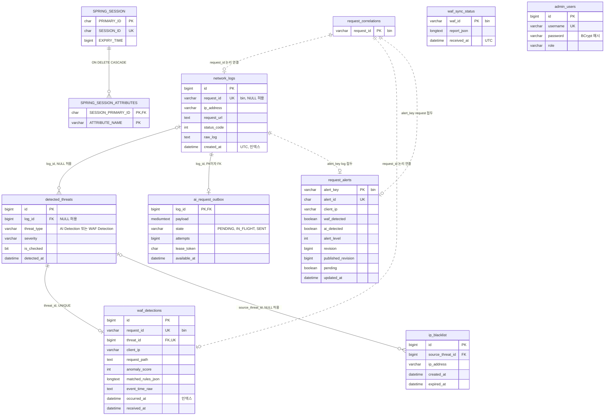

# 데이터베이스 설계

이 문서는 MySQL `security_db`의 테이블 구성·제약·인덱스와 스키마 변경 규칙을 실제 SQL과 엔티티를 근거로 설명한다.

- 기준: 2026/11/08. MySQL 8.0, 문자셋 utf8mb4, 엔진 InnoDB.
- 새 DB 기준: [`security-db-schema.sql`](../db/security-db-schema.sql). 기존 DB 변경: [`docs/db/`](../db/)의 추가 SQL.
- 관련 문서: [06_backend.md](06_backend.md)(트랜잭션·잠금), [03_event_pipeline.md](03_event_pipeline.md), [05_waf_sync.md](05_waf_sync.md), [../operations/aws_deployment.md](../operations/aws_deployment.md), [../operations/cicd.md](../operations/cicd.md).

## 1. 테이블 수와 스키마 파일의 범위

`security-db-schema.sql`은 **8개** 테이블을 만든다. CI가 이어서 적용하는 추가 SQL 3개가 테이블 **3개**와 `network_logs.request_id`를 더해 전체는 **11개**다.

| 구분 | 테이블 |
| --- | --- |
| `security-db-schema.sql`(8개) | `admin_users`, `detected_threats`, `ip_blacklist`, `network_logs`, `SPRING_SESSION`, `SPRING_SESSION_ATTRIBUTES`, `waf_sync_status`, `ai_request_outbox` |
| 추가 SQL(3개) | `waf_detections`(`add-waf-detections.sql`), `request_correlations`(`add-request-correlation.sql`, `network_logs.request_id`·UNIQUE 포함), `request_alerts`(`add-request-alerts.sql`) |

스키마 파일만으로는 엔티티와 맞지 않는다(`network_logs.request_id`, `waf_detections` 없음). [CI](../../.github/workflows/ci.yml)는 스키마 → `add-waf-detections.sql` → `add-request-correlation.sql` → `add-request-alerts.sql` 순서로 적용한다. `compose.aws.yaml`은 빈 볼륨의 최초 초기화 때 스키마 파일 하나만 `01-schema.sql`로 실행한다. 따라서 새 EC2 DB에는 나머지 3개를 백엔드 기동 전에 직접 적용해야 한다. 누락하면 `validate`가 실패할 것으로 예상한다(실행 확인 안 함).

## 2. ERD

실선은 FK, 점선은 FK 없이 키 값으로만 이어지는 논리 연결이다. 주요 컬럼만 표시한다.

## 3. 테이블별 목적

| 테이블 | 목적 | 접근 방식 |
| --- | --- | --- |
| `network_logs` | WAF access 로그 원본. 요청 1건이 행 1개이며 AI 분석 대상 | JPA `LogEntry` |
| `detected_threats` | AI·WAF 탐지의 공통 기록. `threat_type`으로 출처를 구분하고 위협 목록·자동 차단 원인에 쓴다 | JPA `DetectedThreat` |
| `waf_detections` | WAF 탐지 상세(일치 규칙 JSON, 이상 점수, 원문 시각). 원본 로그가 아직 없어도 보존 | JPA `WafDetection` |
| `request_correlations` | 요청 ID별 잠금 행. 데이터를 담지 않고 같은 요청의 처리를 직렬화하는 지점 | JdbcTemplate(`RequestCorrelationService`) |
| `request_alerts` | 요청 단위로 합친 알림 상태와 발행 대기(`revision`, `published_revision`, `pending`) | JdbcTemplate(`RequestAlertRepository`) |
| `ai_request_outbox` | 로그 저장과 같은 트랜잭션에 쌓는 AI 요청 발행 작업 | JdbcTemplate(`AiRequestOutboxRepository`) |
| `ip_blacklist` | 수동·자동 차단 IP와 원인 위협. WAF 스냅샷의 원천 | JPA `IpBlacklist` |
| `waf_sync_status` | WAF별 마지막 동기화 보고 원문과 수신 시각 | JPA `WafSyncStatus` + 네이티브 upsert |
| `admin_users` | 관리자 계정(BCrypt 해시, 역할) | JPA `AdminUser` |
| `SPRING_SESSION`, `SPRING_SESSION_ATTRIBUTES` | Spring Session JDBC 표준 테이블. `spring-session` 의존성이 없어 현재 사용하지 않는다 | 없음 |

원본 로그(`network_logs`)와 분석 결과(`detected_threats`)를 분리하고, 출처별 상세는 별도 테이블(`waf_detections`)에 둔다. 새 탐지 출처를 추가해도 공통 목록 구조는 유지된다.

## 4. 핵심 제약·인덱스와 근거

| 이름 | 대상 | 종류 | 근거 |
| --- | --- | --- | --- |
| `uk_network_logs_request_id` | `network_logs(request_id)` | UNIQUE | Fluent Bit 재전송·Kafka 재처리에도 같은 요청 로그는 1건. 과거 로그는 NULL |
| `uk_waf_detections_request_id` | `waf_detections(request_id)` | UNIQUE | 같은 요청의 WAF 이벤트는 1건. 동시 처리 시 `WafDetectionService`가 위반을 중복으로 판정 |
| `uk_waf_detections_threat_id`, `fk_waf_detections_threat` | `waf_detections(threat_id)` | UNIQUE + FK | 위협 1건과 WAF 상세 1건을 일대일로 고정 |
| PK `request_id` | `request_correlations` | PK | `INSERT ... ON DUPLICATE KEY UPDATE`로 요청별 행 잠금 획득 |
| PK `alert_key`, `uk_request_alerts_alert_id` | `request_alerts` | PK, UNIQUE | `request:<요청 ID>` 또는 `log:<로그 ID>` 키로 WAF·AI 알림을 합치고, 화면용 UUID를 고유하게 유지 |
| `idx_request_alerts_pending` | `request_alerts(pending, updated_at)` | INDEX | 발행기의 `pending = TRUE ORDER BY updated_at` 조회 |
| PK `log_id`, `fk_ai_outbox_log` | `ai_request_outbox` | PK + FK | 로그 1건당 AI 요청 작업 1건 |
| `idx_ai_outbox_ready` | `ai_request_outbox(state, available_at, log_id)` | INDEX | 발행 가능 행 선점(`ORDER BY available_at, log_id ... FOR UPDATE SKIP LOCKED`) |
| `idx_network_logs_created_at` | `network_logs(created_at)` | INDEX | 대시보드 로그 목록의 `created_at` 내림차순 페이지가 전체 스캔·정렬하던 문제. EC2 5 RPS 부하 중 평균 127.7ms → 0.7ms, 호출당 검사 16,996 → 5.5행([트러블슈팅_3](<../testing/ec2/트러블슈팅_3(상세본).md>)) |
| `idx_waf_detections_occurred_at` | `waf_detections(occurred_at)` | INDEX | 발생 시각 조회용. 현재 이 컬럼으로 조회하는 저장소 쿼리는 없다 |
| `UK3fgxk4ewgaxgtgvqwb1jjudj6` | `admin_users(username)` | UNIQUE | 로그인 아이디 고유(엔티티 `unique = true`로 생성된 이름) |
| `FKp5y1cn4hp7qs4ng46dmdb8aj1`, `FKgih3ksr4le14l43h4h4kojalo` | `detected_threats(log_id)`, `ip_blacklist(source_threat_id)` | FK | 위협 → 원본 로그, 차단 → 원인 위협. 블랙리스트 삭제는 원본·탐지 이력을 지우지 않는다 |

- 요청 ID 컬럼과 `request_correlations`·`request_alerts`·`waf_sync_status`·`ai_request_outbox` 테이블은 `utf8mb4_0900_bin`이다. WAF가 만든 `request_id`의 대소문자를 구분해 비교하기 위해서다.
- UNIQUE 제약은 요청별 잠금·저장 트랜잭션과 함께 동작하는 마지막 방어선이다([06_backend.md](06_backend.md) 3절).

## 5. 마이그레이션 SQL 목록과 적용 순서

| 파일 | 추가 커밋 날짜 | 목적 | 새 DB에 실행 |
| --- | --- | --- | --- |
| `add-waf-detections.sql` | 2026/10/18 | `waf_detections` 생성 | 필요(CI 2번째) |
| `add-request-correlation.sql` | 2026/10/18 | `network_logs.request_id` + UNIQUE, `request_correlations` 생성 | 필요(CI 3번째) |
| `add-request-alerts.sql` | 2026/10/18 | `request_alerts` 생성 | 필요(CI 4번째) |
| `alter-network-logs-request-url.sql` | 2026/10/21 | `request_url` VARCHAR(255) → TEXT | 불필요(스키마에 TEXT) |
| `add-waf-sync-status.sql` | 2026/10/27 | `waf_sync_status` 생성 | 불필요(스키마 포함, 재실행 시 오류) |
| `add-ai-request-outbox.sql` | 2026/11/05 | `ai_request_outbox` 생성 | 불필요(스키마 포함, 재실행 시 오류) |
| `add-network-logs-created-at-index.sql` | 2026/11/07 | 온라인 DDL(`ALGORITHM=INPLACE, LOCK=NONE`, `lock_wait_timeout=5`)로 인덱스 추가. 사전 확인 쿼리·되돌리기 문 포함 | 불필요(스키마 포함) |

- **새 DB**: 스키마 → `add-waf-detections.sql` → `add-request-correlation.sql` → `add-request-alerts.sql`(CI와 같은 순서). 나머지 4개는 이미 반영돼 있어 실행하지 않는다.
- **기존 DB**: `SHOW TABLES`, `SHOW INDEX`, `information_schema`로 현재 구조를 먼저 확인하고 빠진 변경만 위 표의 날짜 순으로 적용한다. 초기 스키마나 추가 SQL을 일괄 재실행하지 않는다. `waf_detections`는 `detected_threats`, `ai_request_outbox`는 `network_logs`를 참조하므로 기준 테이블이 먼저 있어야 한다.
- 로컬과 EC2의 적용 여부를 각각 확인·기록한다. 앱 이미지 롤백은 DB를 되돌리지 않는다. 운영 SQL 실행 절차는 [../operations/aws_deployment.md](../operations/aws_deployment.md)를 따른다.

## 6. `ddl-auto: validate` 규칙

- `spring.jpa.hibernate.ddl-auto: validate`는 기동 시 JPA 엔티티 6개의 테이블·컬럼·타입을 **검사만** 한다. 엔티티를 고쳐도 기존 DB는 바뀌지 않는다.
- **검사하지 않는 것**
  - 인덱스: `LogEntry`의 `@Index` 선언은 의도 표시일 뿐이다(엔티티 주석에도 명시). 인덱스는 SQL로 적용한다.
  - JdbcTemplate 전용 테이블 `ai_request_outbox`·`request_alerts`·`request_correlations`: 누락돼도 기동은 성공한다. 그 뒤 첫 로그 저장·알림 기록에서 SQL 오류가 난다. 특히 `LogService`는 `AI_OUTBOX_ENABLED`와 무관하게 항상 outbox에 등록하므로 `ai_request_outbox`가 없으면 로그 저장 자체가 실패한다.
- **자동 마이그레이션 없음**: `application.yml`에 `spring.flyway.*` 설정이 있지만 `build.gradle`에 Flyway 의존성이 없고 `db/migration` 디렉터리도 없다. SQL이 자동 실행된다고 가정하지 않는다.
- MySQL 초기화 스크립트는 빈 데이터 볼륨의 최초 기동 때만 실행된다. 배포 워크플로와 `scripts/deploy.sh`도 SQL을 실행하지 않는다.
- 컬럼·테이블을 바꿀 때는 엔티티, 기존 DB용 `docs/db/` SQL, 새 DB용 `security-db-schema.sql`, 필요하면 CI 초기화 순서까지 함께 고친다. 테이블 누락을 `create`·`update` 설정으로 해결하지 않는다.

## 7. 시간 컬럼

시간 컬럼은 모두 시간대 정보가 없는 `DATETIME(6)`이다. 애플리케이션 규칙은 **UTC 기준 `LocalDateTime`**이다. 다만 DB 원문 값의 시간대는 기록 방법에 따라 다르다(아래 확인 결과).

| 컬럼 | 기록 방법 |
| --- | --- |
| `network_logs.created_at`, `detected_threats.detected_at`, `ip_blacklist.created_at`, `waf_detections.received_at` | JPA, `UtcDateTime.now()` |
| `waf_detections.occurred_at` | 원문 `event_time_raw` 보존, `WAF_EVENT_ZONE`으로 해석해 UTC 변환. 해석 실패 시 NULL |
| `ai_request_outbox`·`request_alerts`의 시각 컬럼 | DB 함수 `UTC_TIMESTAMP(6)` |
| `waf_sync_status.received_at` | `Clock.systemUTC()` |
| `ip_blacklist.expired_at` | 코드에서 설정하지 않는다(만료 정책 미구현) |
| `SPRING_SESSION`의 시각 | epoch 밀리초 BIGINT(미사용 테이블) |

- API는 UTC 오프셋을 붙여 응답하고 화면은 `Asia/Seoul`로 표시한다([06_backend.md](06_backend.md) 5절).
- **DB 원문 값의 시간대는 기록 방법에 따라 다르다(EC2 확인, 2026/11/08).** JPA로 저장한 `network_logs.created_at`은 DB 안에서 KST 벽시계 값으로 보인다. 예를 들어 log 36476의 원문은 `12:53:39.646`인데, 같은 요청의 DG_TRACE 로그 커밋 시각은 `03:53:39.655Z`였다. DB `time_zone`은 `SYSTEM`(UTC)이었다([수집 쿼리 진단 증거](../testing/ec2/evidence/20261108-collection-query-plan.json)). 반면 `UTC_TIMESTAMP(6)`로 쓰는 outbox·알림 시각의 원문은 UTC다.
  - 원인 가설(미검증): JDBC URL의 `serverTimezone=Asia/Seoul` 때문에 드라이버가 저장할 때 +9시간, 읽을 때 −9시간으로 바꾼다고 본다. 이 가설대로라면 애플리케이션이 읽는 값은 UTC로 돌아오므로 API 응답에는 영향이 없다.
  - 2026/11/01 로컬 r08 진단에서도 JPA 저장값을 +09:00으로 해석해야 관측 순서가 맞았다([server-observation.md](../testing/local/server-observation.md)).
  - 따라서 DB에서 직접 쿼리해 JPA 컬럼과 `UTC_TIMESTAMP(6)` 컬럼을 비교하거나 범위를 자를 때는 해석 기준을 명시한다. 측정 실행기의 DB 수집 쿼리는 이 차이를 피하려고 시각 대신 id 하한을 쓴다([트러블슈팅_8](<../testing/ec2/트러블슈팅_8(상세본).md>)).
- 테스트 입력 형식(`{"log": ...}`) 경로의 `created_at`은 `LocalDateTime.now()`로 기록된다. 실제 WAF access JSON 경로와 구분한다.

## 8. 긴 값과 문자열

- `network_logs.request_url`은 `TEXT`다(2026/10/21 확장). 긴 URL을 다룰 때는 DTO·저장·조회·WAF 경로를 함께 확인한다.
- `network_logs.raw_log`(TEXT)에는 access 로그 JSON 전체가 들어간다. WAF 로그 형식이 `request_body`를 포함하므로 요청 본문도 저장된다([08_security.md](08_security.md)).
- `waf_detections.request_method`·`request_path`는 TEXT, `matched_rules_json`은 LONGTEXT, `ai_request_outbox.payload`는 MEDIUMTEXT다. `request_id`는 VARCHAR(255)이고 서비스가 1~255자를 검증한다.

## 9. 알려진 한계

- `ip_blacklist.ip_address`에 UNIQUE가 없다. 중복 방지는 `BlacklistService.isBlocked` 조회에 의존하므로 같은 IP의 서로 다른 요청이 동시에 자동 등록되면 중복 행이 생길 수 있다(재현 안 함).
- 보존 기간·정리 작업이 없다. `network_logs`, `detected_threats`, `ai_request_outbox`(`SENT` 행 유지), `request_alerts`, `request_correlations`가 계속 늘어난다.
- `raw_log`가 TEXT 상한(65,535바이트)을 넘는 원문을 어떻게 처리하는지는 (미확인)이다. `SPRING_SESSION` 두 테이블은 스키마에만 있고 쓰이지 않는다.
- 새 DB 초기화가 스키마 파일 하나로 끝나지 않는다(1절). 스키마 파일 통합은 별도 작업이다.

## 결정 · 대안 · 근거

| 결정 | 검토한 대안 | 선택 근거 | 관련 문서·코드 |
| --- | --- | --- | --- |
| `ddl-auto: validate` + 수동 SQL(`docs/db/`) | `update`·`create`, Flyway 자동 실행 | 운영 데이터를 기동 설정이 바꾸지 않게 하고 적용 시점을 사람이 통제한다. Flyway 설정만 있고 의존성은 없으며, 도입하려면 기존 DB 기준점 등록이 먼저 필요하다(`baseline-on-migrate: false` 주석) | `application.yml`, AGENTS.md DB 변경 |
| `request_id` UNIQUE(대소문자 구분 `utf8mb4_0900_bin`) | IP·시각 조합 매칭, 애플리케이션 중복 확인만 | 도착 순서 역전·재전송에도 요청당 1건을 DB가 보장한다. IP·시각은 같은 요청을 식별하지 못한다 | `add-request-correlation.sql`, `add-waf-detections.sql` |
| 별도 잠금 테이블 `request_correlations` | `network_logs` 행 잠금, `waf_detections` 행 잠금 | WAF 이벤트가 먼저 오면 잠글 로그 행이 아직 없다. 어느 쪽이 먼저 와도 같은 키를 잠글 수 있는 행이 필요하다 | `RequestCorrelationService` |
| outbox·알림 테이블은 JdbcTemplate | JPA 엔티티와 저장소 | `FOR UPDATE SKIP LOCKED`, 임대 토큰 조건부 UPDATE, `UTC_TIMESTAMP(6)`을 SQL로 그대로 표현한다. 대가로 `validate`가 테이블 누락을 잡지 못한다 | `AiRequestOutboxRepository`, `RequestAlertRepository` |
| 애플리케이션 시간은 UTC `LocalDateTime`, 컬럼은 `DATETIME(6)` | KST 기준, `TIMESTAMP` 타입 | 서버·DB·브라우저 시간대가 달라도 앱이 다루는 값의 의미를 하나로 두고 표시에서만 변환한다. JPA 컬럼의 DB 원문이 KST처럼 보이는 차이는 7절에 기록했다 | `UtcDateTime` |
| `network_logs(created_at)` 인덱스 | 정렬 기준을 `id`로 변경, 총 건수 생략·근사, 대시보드 갱신 빈도 조절 | API 정렬 의미를 바꾸지 않는 최소 변경이고 앱 배포 없이 온라인 DDL로 적용된다. 같은 조건 재측정으로 효과를 확인했다 | [트러블슈팅_3](<../testing/ec2/트러블슈팅_3(상세본).md>) |
