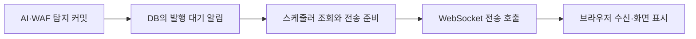

# EC2 알림 발행 지연 · 핵심 요약

**2026/11/07 · 250ms 비교 완료 및 EC2 운영 적용** · [상세 해결 과정](<트러블슈팅_1(상세본).md>)

## 문제 상황 흐름

## 문제 상황

- EC2 5 RPS·120초·3회에서 요청 → AI 결과 저장 p95는 **1.05초**, 요청 → AI 알림 화면 표시 p95는 **1.99초**였다. [5 RPS 기준선](runs/20261106-ec2-5rps-baseline-review.md)

## 해결 과정

- 확인 요청 36건을 `requestId`로 연결해 **탐지 커밋 → 전송 호출 시작**과 **전송 호출 시작 → 반환**을 각각 계산했다. 전송 시작 전 p95는 AI **867.5ms**·WAF **974.7ms**, 전송 호출 p95는 AI **2.7ms**·WAF **3.9ms**였다.
- 알림은 DB에 발행 대기로 저장되고, 발행기가 직전 작업을 끝낸 뒤 기본 **1,000ms**를 기다려 다시 조회한다. 관측된 대기와 코드의 기본 주기가 맞아떨어져 조회 주기를 첫 검증 변수로 잡았다. [알림 발행 코드](../../../backend/src/main/java/com/example/security_log_system/service/RequestAlertDispatcher.java#L25)

## 결과

250ms 설정의 5 RPS·120초 세 회차가 모두 PASS했다. 커밋 후 전송 시작 p95 400ms 목표를 **충족**했다. [r10](runs/20261107T134708+0900-ec2-e2e-rps5-r10.md) · [r12](runs/20261107T140040+0900-ec2-e2e-rps5-r12.md) · [r13](runs/20261107T140627+0900-ec2-e2e-rps5-r13.md)

| 지표 | 1,000ms | 250ms | 변화 |
| --- | ---: | ---: | ---: |
| AI 커밋 → 전송 시작 p95 | 867.5ms | 249.5ms | 71.2% 감소 |
| WAF 커밋 → 전송 시작 p95 | 974.7ms | 249.3ms | 74.4% 감소 |
| 요청 → AI 알림 표시 p95 | 1,992.0ms | 1,814.3ms | 8.9% 감소 |
| 요청 → WAF 알림 표시 p95 | 1,496.4ms | 946.5ms | 36.7% 감소 |
| 발행 대기 목록 SQL 조회 | 1.00회/초 | 3.94회/초 | 3.95배 |

측정 1,800건이 저장·AI 처리됐고, 확인 요청 36건 모두 두 출처의 알림이 표시됐다. 같은 알림을 여러 번 전송한 요청은 13건에서 33건으로 늘었고 중복 팝업은 0건이었다.

p99(36표본, 참고값)도 AI 커밋 → 전송 시작 968.1 → 251.7ms, WAF 992.0 → 250.6ms로 줄었다. 최대값도 조회 주기 250ms 근처에서 끊겨, 조회 대기가 꼬리 지연의 상한이었다는 해석과 맞는다. [단계별 p99 추이](runs/20261107-ec2-p99-trend-ts1-ts4.md)

EC2 설정은 2026/11/07 14:12:10 +09:00에 1,000ms로 원복했다. 백엔드 health UP, WAF 상태와 임시 제외 복구, 필수 Kafka lag 0과 서비스 9개 실행을 확인했다. [집계·설정·원복 증거](evidence/20261107-alert-poll-250ms-comparison.json)

실험 결과를 검토한 뒤 2026/11/07 14:20:56 +09:00에 EC2 운영 백엔드에 250ms를 적용했다. 백엔드 UP, WAF 정상, 서비스 9개 실행, 필수 Kafka lag 0을 확인했다. [운영 적용 증거](evidence/20261107-alert-poll-250ms-operating.json)

화면 표시 지연의 전후 비교에는 브라우저 버전과 호스트 상태 차이가 있다. Nginx가 재시작된 r11은 비교 집계에서 제외했다. [상세 해결 과정](<트러블슈팅_1(상세본).md>)

## 검증 방법을 고른 이유

- **조회 주기 1,000ms → 250ms**를 첫 비교 변수로 선택했다. 발행 대기 DB 행과 재시도·알림 revision 구조를 유지하면서 조회 횟수와 WAF 선발행 후 AI 갱신 횟수를 함께 확인할 수 있었다.
- 커밋 후 즉시 실행을 깨우는 방식도 검토한다. 동시 실행 제어와 실패 시 주기적 복구가 필요하므로, 먼저 설정 비교로 원인의 크기를 확인한다.
