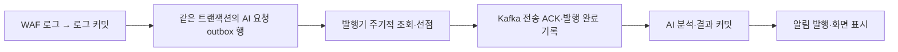

# EC2 AI 요청 outbox 발행 지연 · 핵심 요약

**2026/11/07 · 250ms 비교 완료 및 EC2 운영 적용** · [상세 해결 과정](<트러블슈팅_2(상세본).md>)

## 문제 상황 흐름

## 문제 상황

- 알림 발행을 250ms로 줄인 뒤에도 요청 → AI 알림 화면 표시 p95는 **1,814.3ms**였다. 같은 세 회차에서 AI 요청 outbox 생성 → 발행 완료 기록은 1,800건 가중 평균 **300.9ms**였고, 관련 SQL의 문장 평균은 1ms 미만이었다. [이전 측정](<트러블슈팅_1(상세본).md>)

## 해결 과정

- AI 요청 outbox 발행기는 직전 실행이 끝난 뒤 **500ms**를 기다렸다가 DB를 다시 조회한다. SQL이 빠른데 발행까지 약 300ms가 걸려, 조회 대기를 첫 가설로 잡았다. [AI outbox Dispatcher](../../../backend/src/main/java/com/example/security_log_system/service/AiRequestOutboxDispatcher.java#L25)
- 같은 EC2 이미지에서 알림 발행 250ms는 그대로 두고 **AI outbox 조회 대기만 500ms → 250ms**로 바꿨다. 5 RPS·120초·3회를 측정했다. 회차마다 설정·이미지·백엔드 재시작 여부를 대조했고, 측정 후 500ms로 원복했다.

## 결과

250ms 세 회차 r14~r16이 모두 PASS했다. outbox 발행 평균과 AI 결과 커밋 p95는 세 회차 모두 기준선 세 회차보다 낮았다. [r14](runs/20261107T143741+0900-ec2-e2e-rps5-r14.md) · [r15](runs/20261107T144314+0900-ec2-e2e-rps5-r15.md) · [r16](runs/20261107T144857+0900-ec2-e2e-rps5-r16.md)

| 지표 | 500ms | 250ms | 변화 |
| --- | ---: | ---: | ---: |
| outbox 생성 → 발행 완료 평균 | 300.9ms | 163.7ms | 45.6% 감소 |
| 로그 커밋 → AI 결과 커밋 p95 | 754.8ms | 526.3ms | 30.3% 감소 |
| 요청 → AI 결과 커밋 p95 | 1,172.7ms | 926.9ms | 21.0% 감소 |
| 요청 → AI 알림 표시 p95 | 1,814.3ms | 1,560.5ms | 14.0% 감소 |
| outbox 선점 SELECT | 5.65회/초 | 7.38회/초 | 1.31배 |

- 평균 감소폭 137.2ms는 조회 주기를 절반으로 줄였을 때의 추정 감소량 약 125ms와 같은 규모다.
- 1,800건 저장·AI 완료, 확인 요청 36건의 두 출처 알림 표시를 확인했다. 발행 오류와 재시도는 0건이었다.
- 화면 표시 p95는 36표본이고 회차별 범위가 겹친다. AI outbox와 무관한 WAF 화면 표시도 7.5% 줄었으므로 화면 지연 감소 전체를 이 설정의 효과로 보지 않는다.
- p99: 로그 커밋 → AI 결과 커밋은 1,049.6 → 742.0ms로 합산값이 낮아졌다. 하지만 p95와 달리 회차별 범위가 겹쳐 꼬리 지연 개선의 근거로 쓰지 않는다. outbox 발행 지연은 평균만 측정했다. [단계별 p99 추이](runs/20261107-ec2-p99-trend-ts1-ts4.md)
- 2026/11/07 14:54:30 +09:00에 500ms로 원복했다. 백엔드 UP, WAF 정상·제외 목록 복구, 필수 Kafka lag 0, 서비스 9개 실행을 확인했다. [집계·설정·원복 증거](evidence/20261107-ai-outbox-poll-250ms-comparison.json)
- 결과 검토 후 2026/11/07 15:05:51 +09:00에 EC2 운영 백엔드에 250ms를 적용했다. 같은 이미지에서 두 조회 설정 250ms, 백엔드 UP, WAF 정상, 필수 Kafka lag 0, 서비스 9개 실행을 확인했다. 다음 CD용 AWS Compose 기본값도 250ms로 바꿨다. [운영 적용 증거](evidence/20261107-ai-outbox-poll-250ms-operating.json)

## 검증 방법을 고른 이유

- **조회 주기 500ms → 250ms**는 코드 변경 없이 기존 이미지의 설정 하나만 바꿔 원인의 크기를 확인할 수 있었다. 원복도 백엔드 재생성 한 번으로 끝난다.
- 커밋 후 발행기를 즉시 깨우는 방식은 지연을 더 줄일 수 있다. 하지만 동시 실행 제어, 깨우기 신호 유실, 재시작 후 주기적 복구를 함께 구현·검증해야 한다. 그래서 설정 비교로 조회 대기의 기여를 먼저 확인했다.
- 남은 약 164ms를 나누려면 같은 `logId`의 선점 완료·Kafka ACK 시각 계측이 필요하다. 이번 비교에서는 계측을 추가하지 않았다.
