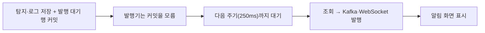

# EC2 발행기 조회 대기 제거(커밋 직후 깨우기) · 핵심 요약

**2026/11/07 · 구조 개선 코드·테스트 완료 · 배포·재측정 대기** · [상세 해결 과정](<트러블슈팅_5(상세본).md>)

## 문제 상황 흐름

## 문제 상황

- 트러블슈팅_4 이후 공격 → AI 알림 화면 표시 p95는 **1,133ms**로 1초 목표에 못 미쳤다.
- 확인 요청 36건에서 **탐지 커밋 → 알림 전송 시작**이 AI 평균 121.4ms·p95 226.5ms, WAF 평균 127.5ms·p95 232.0ms였다. AI outbox 발행 평균은 152.0ms였다. 모두 0~250ms 주기 대기 모양이다.
- 주기를 줄이면 대기는 줄지만 평균 주기/2는 남고, 빈 조회는 주기에 반비례해 늘어난다(트러블슈팅_1·2에서 확인).

## 해결 과정

- 저장 트랜잭션이 **커밋된 직후** 발행기를 한 번 바로 실행하도록 바꿨다(`TransactionSynchronization.afterCommit`). 주기 조회는 신호 유실·재시도·재시작을 위한 복구 경로로 남겼다.
- 깨우기 작업은 각 발행기가 쓰던 **단일 스레드 스케줄러**에 넣는다. 그래서 주기 실행과 동시에 돌지 않는다. 예약 표시(`AtomicBoolean`)로 신호를 하나로 합치고, 실행 시작 때 표시를 지워 실행 중 커밋도 놓치지 않는다.
- 커밋 전 실행, 롤백, 신호 폭주, 실행 중 커밋, 실패 격리, 끄기 플래그를 단위 테스트로, 실제 빈 연결과 실행 스레드를 DB 없는 Spring 테스트로 확인했다. 기존 168개 테스트는 실패 0이다.

## 결과

미실행. 배포 후 같은 5 RPS·3회 조건에서 측정한다. 목표는 배포 전에 정했다.
- 탐지 커밋 → 전송 시작 p95: AI·WAF 각각 50ms 이하
- AI outbox 발행 평균: 60ms 이하
- AI 알림 p95 1초 미만 여부는 참고 지표로 기록

## 해결과정에 쓴 방법을 써야만 했던 이유

- **트랜잭션 안에서 바로 전송하지 않음:** DB 롤백과 메시지 전송이 어긋나는 문제를 막으려고 outbox를 도입했다. 이 안전장치를 유지한 채 "언제 꺼내 보낼지"만 앞당겼다.
- **폴링을 없애지 않음:** 깨우기 신호는 사라질 수 있다(종료 중, 예외). 무엇을 보낼지는 여전히 DB가 결정하므로 주기 조회가 결국 처리한다.
- **별도 스레드 풀(`@Async`) 대신 기존 단일 스레드:** 발행기가 동시에 여러 개 돌지 않게 하려고 새 잠금을 만드는 대신, 실행 위치를 하나로 모았다.
- **설정으로 끌 수 있게:** 문제가 생기면 이미지 재배포 없이 환경 변수로 기존 동작으로 되돌린다.
