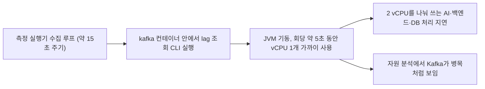

# EC2 측정 도구 부담 · 핵심 요약

**2026/11/07 · 실행기 개선·재측정 완료(부분 충족) · Kafka healthcheck 부담 새로 확인** · [상세 해결 과정](<트러블슈팅_6(상세본).md>)

## 문제 상황 흐름

## 문제 상황

- 단계 부하 계획을 세우려고 5 RPS 회차의 자원 사용량을 다시 읽었다. 호스트 CPU가 평균 62.8~73.7%로 높았고, 가장 많이 쓰는 컨테이너가 Kafka(평균 24.5~78.9%, 순간 최대 188.4%)였다.
- 초당 5건을 주고받는 브로커로는 지나치게 큰 값이었다. 계획 초안에서는 이를 다음 병목 후보로 잘못 적었다.

## 해결 과정

- 측정 실행기의 lag 조회 실행 시각과 `docker stats` 표본 시각을 여섯 회차(r17~r19, r21~r23)에서 대조했다.
- lag 조회 CLI가 도는 동안 Kafka CPU 중앙값은 27.6~131.7%였다. 그 외 시간에는 2.7~6.6%였다. 같은 수집에 들어 있는 DB 조회는 DB CPU에 차이를 만들지 않았다.
- 요청별 DG_TRACE로, CLI가 도는 동안 로그가 커밋된 요청과 그렇지 않은 요청의 지연을 나눠 비교했다.

## 결과

| 지표 | 값 |
| --- | --- |
| lag 조회 CLI 실행 | 측정 120초에 8회, 회당 4.6~5.2초. 구간의 30~35% |
| Kafka 컨테이너 CPU 급등 부담 | 회차별 약 0.2~0.76 vCPU, 중앙값 약 0.5 vCPU. 재측정 후 lag 조회와 healthcheck CLI가 섞인 값으로 정정 |
| Kafka 브로커 자체 CPU | 2.7~6.6% |
| 로그 커밋 → AI 결과 커밋 평균, CLI 실행 중 vs 외 | 여섯 회차 모두 실행 중이 21~61ms 더 김 |
| 같은 지표 p95 차이 | Flush 0.5 회차 +72.3ms, Flush 0.1 회차 +35.8ms |

- 측정 도구가 측정 대상 서버의 CPU를 쓰고 있었다. 처음에는 서버의 약 1/4로 추정했지만, 재측정 결과 그중 일부는 Kafka healthcheck 몫이었다(아래 재측정).
- 트러블슈팅_1~5는 전후 모두 같은 측정 방식을 써서 상대 비교는 유지된다. 절대값에는 이 부담이 들어 있다.
- 지연 증가는 상관까지 확인했다. 인과는 측정 방식을 바꾼 뒤 같은 조건 재측정으로 확인한다. [진단 증거](evidence/20261107-measurement-overhead-kafka-lag-cli.json)

## 해결과정에 쓴 방법을 써야만 했던 이유

- 컨테이너 CPU 평균만으로는 Kafka 부하인지 측정 도구 부담인지 구분할 수 없었다. 측정 도구가 남긴 실행 시각과 자원 표본 시각을 맞춰야 출처를 가를 수 있었다.
- 같은 수집에 들어 있는 DB 조회도 같은 방식으로 대조해서 후보에서 뺐다.
- 개선은 실행기의 lag 조회 주기를 줄이는 방식이 가장 작다. 실행기 코드만 바꾸면 되고 앱 배포나 EC2 설정 변경은 필요 없다. 상주형 수집기는 해상도는 좋지만 EC2에 측정용 컨테이너를 추가해야 해서 보류했다.
- 2026/11/07에 부하 중 lag 조회를 60초 간격으로 분리하고 측정 계약을 개정 3으로 올렸다. 적체 해소 판정(10초 간격 lag 0 두 번 연속)은 그대로이고, 실행기 회귀 테스트 269개가 통과했다.

## 재측정 결과 (r30~r32, 같은 이미지·설정)

| 지표 | 개정 2 r27~r29 | 개정 3 r30~r32 | 판정 기준 |
| --- | ---: | ---: | --- |
| 측정 구간 lag 조회 | 8회 | 2회 | 3회 이하 충족 |
| 호스트 CPU 평균 | 73.9~75.2% | 61.3~66.0% | 감소 충족 |
| Kafka 컨테이너 평균 CPU | 35.1~36.9% | 23.2~35.7% | 10% 이하 미달 |
| 요청 → AI 결과 커밋 p95 / p99 (참고) | 568 / 1,058ms (예열 r28·r29: 442 / 749ms) | 382 / 589ms | — |

- 판정은 부분 충족이다. 호스트 CPU가 약 0.21 vCPU 줄어 조회 6회를 없앤 추정치와 맞았다. 측정 도구 자체의 부담은 서버 CPU의 약 1/10 수준이었다.
- Kafka CPU가 덜 줄어든 원인을 새로 찾았다. Docker healthcheck가 15초마다 `kafka-topics --list`를 실행하는데, 이것도 JVM을 새로 띄우는 CLI다. 측정할 때만이 아니라 운영 중에도 상시 돈다.
- r30~r32를 이후 5 RPS 기준선으로 쓴다. [비교 증거](evidence/20261107-measurement-overhead-rev3-comparison.json)
