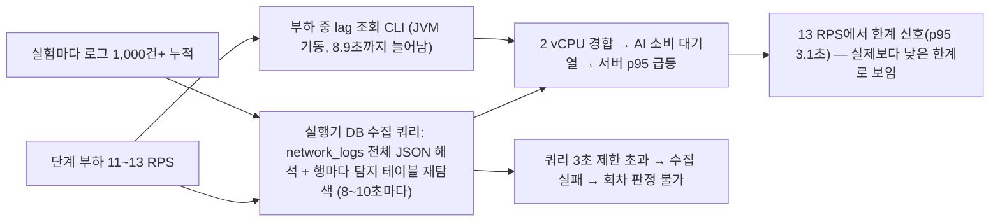
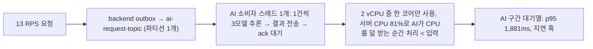

# 단계 부하 한계 측정과 AI 소비 병목 · 핵심 요약

**2026/11/08 · 1부 측정 도구 부담: 개선·재측정 완료 · 2부 AI 구간 대기열: 대안 A 배포·재측정 완료, 판정 미충족(가설 기각)** · [상세 해결 과정](<트러블슈팅_8(상세본).md>)

# 1부. 측정 도구 부담이 한계를 낮게 보이게 함

## 문제 상황 흐름

## 문제 상황

- 처리 한계(knee)를 찾으려고 7 → 9 → 11 → 13 RPS로 단계 부하를 걸었다. 13 RPS에서 처음 한계 신호가 나왔다(서버 p95 3,128.8ms, 기준 3초).
- 그런데 같은 조건을 다시 재자 결과가 재현되지 않았다. 11 RPS의 p95가 586ms에서 2,030ms로 바뀌었고, 실행기 자신의 DB 수집 쿼리가 실행 시간 제한(MySQL `3024`)에 걸려 회차가 판정 불가(INCONCLUSIVE)로 끝났다.
- 측정 도구가 측정 대상 서버를 흔들고 있었고, 그 크기가 실험할수록 커지고 있었다.

## 해결 과정

- 원격 수집 명령의 실행 시각과 5초 단위 지연 추이를 맞춰 봤다. 가장 큰 지연 혹이 lag CLI와 느린 DB 쿼리 시점과 겹쳤다. 13 RPS에서는 수집 실패 뒤 lag CLI가 60초가 아니라 25초 만에 다시 돌았다.
- 실패 원인 코드를 남기도록 실행기를 고쳤더니 `3024/HY000`(문장 실행 시간 초과)이 나왔다. 수집 쿼리를 EC2에서 읽기 전용 `EXPLAIN ANALYZE`로 분석했다. 비용은 두 곳이었다.
  - 이번 회차 행을 찾으려고 `network_logs` 전체 37,152행의 JSON을 해석했다(약 0.59초).
  - `BINARY` 비교 때문에 인덱스를 못 타고, 행마다 `waf_detections` 851행을 다시 훑었다(약 0.88초).
- 수정은 두 가지다.
  - **DB 수집 쿼리:** 회차 시작 전 최대 로그 id를 하한으로 두는 기본 키 범위 조회로 바꾸고, 조인은 인덱스를 타게 했다. 시각(`created_at`)에 의존하지 않는다는 기존 설계 원칙은 유지했다.
  - **lag 조회:** 부하 중에는 끄고, 측정 후 적체 확인 때만 돈다.
- 같은 배포·같은 backend 상태에서 5 RPS 1회와 11·13 RPS 각 3회를 다시 쟀다.

## 결과

| 지표 | 개선 전 | 개선 후 |
| --- | --- | --- |
| DB 수집 쿼리 DB 실행 시간 (EXPLAIN ANALYZE, 같은 1,352행) | 약 1,640ms | **약 24ms** |
| 5 RPS 호스트 CPU 평균 | 58.0% (3회) | **47.1%** (1회) |
| 13 RPS 판정 | FAIL · 서버 p95 3,128.8ms (1회) | **PASS 3/3** · 합산 p95 2,040ms (회차별 1,259~2,265ms) |
| 13 RPS 호스트 CPU 평균 | 89.5% | 80.7~82.0% |
| 11 RPS 판정 | PASS 586ms / INCONCLUSIVE 2,030ms | **PASS 3/3** · 합산 p95 852ms |

- 측정 도구가 5 RPS에서도 부하 CPU의 약 1/5(약 11%p)을 쓰고 있었다.
- 앞선 "13 RPS 한계"는 측정 도구 몫이 컸다. 이제 지연 곡선은 11~13 RPS에서 꺾이고, SLO(p95 3초)를 넘는 처리 한계는 13 RPS 위다.
- 병목은 AI 구간 대기열로 좁혀졌다. 13 RPS에서 로그 수집 p95 204ms, WAF 경로 239ms는 정상이고 AI 구간만 p95 1,881ms다.

## 해결과정에 쓴 방법을 써야만 했던 이유

- **실패 원인 코드부터 남겼다.** 처음에는 실패한 명령이 3.2초에 끝난 것을 보고 연결 제한(3초) 탓으로 추정했다. 코드 하나(`3024`)로 실행 시간 초과임이 바로 드러나 추정을 정정했다. 보안상 오류 본문은 보내지 않고 오류 번호만 뽑았다.
- **`created_at` 대신 id 하한을 썼다.** `created_at` 범위가 더 직관적이고 인덱스도 있었다. 하지만 기존 테스트가 "수집 쿼리는 시각에 의존하지 않는다"를 지키고 있었다. 시간대 해석이 틀리면 행을 놓친다. id 하한은 시간대와 무관한 정확한 범위다.
- **실행 제한(3초)을 늘리지 않았다.** 늘리면 실패는 사라지지만 측정 도구 부담은 그대로 남아 결과를 계속 흔든다.
- **부하 중 lag 조회는 아예 껐다.** 한계·SLO 판정에 lag를 쓰지 않는다. 간격만 늘리면 CPU가 빠듯할 때 여전히 수 초짜리 교란이 남는다.
- **과정에서 시계 비교 규칙 하나를 조정했다(계약 개정 6).** k6 일반 요청의 PC-EC2 시계 비교가 1~2ms 어긋난 것만으로 회차 전체가 중단됐다. 서버 지연 판정과 무관한 값이라 기록만 남기도록 바꿨다. probe 시각 검증, 보정 만료, 시계 점프 감시는 그대로 중단 조건이다.

# 2부. AI 구간 대기열 구조 개선 (대안 A)

## 문제 상황 흐름

## 문제 상황

- 측정 도구 부담을 줄인 뒤 13 RPS는 3회 모두 SLO를 지켰지만, 서버 p95는 5 → 11 → 13 RPS에서 268 → 852 → 2,040ms로 가파르게 늘었다.
- 다른 구간은 정상이었다. AI 요청 발행(outbox)은 평균 34~39ms, backend의 AI 결과 소비 lag는 0~1, 로그 수집 p95는 204ms다. AI 구간(로그 커밋 → AI 결과 커밋)만 p50 62 → 83 → 133ms, p95 158 → 684 → 1,881ms로 늘었다.

## 해결 과정

- AI 서비스 코드를 읽기만 했다. 백그라운드 스레드 하나가 메시지를 한 건씩 처리한다(3모델 추론 → 결과 전송 → `flush()`로 ack 대기 → 다음 건). `ai-request-topic` 파티션이 1개라 소비자도 1개만 동작하고, uvicorn 워커도 1개다.
- AI 컨테이너 CPU는 메시지당 약 45~50ms로 5·11·13 RPS에서 일관됐다(`docker stats` 평균 ÷ RPS). 소비자 하나가 코어 하나를 다 받아도 초당 약 20건이 상한이다.
- 보조 가설(PyTorch가 vCPU 2개를 써서 다른 서비스와 엉킴)은 EC2 읽기 전용 확인으로 기각했다. 추론 스레드가 이미 1개였다.
- 대안 A를 골랐다. 파티션을 2개로 늘리고, AI 프로세스를 2개(`--workers 2`, 같은 consumer group)로 늘리고, 프로세스당 추론 스레드 1개를 명시했다. AI 코드는 바꾸지 않았다.

## 결과

**판정 미충족 — 가설 기각.** 배포(`1ec9c858`) 후 13 RPS 3회(r05~r07). 판정 기준은 측정 전에 정했다.

| 지표 | 개선 전 (r02~r04) | 개선 후 (r05~r07) | 참고: 첫 회차 제외 (r06·r07) |
| --- | --- | --- | --- |
| 판정 | PASS 3/3 | FAIL 1 · PASS 2 | PASS 2 |
| AI 구간 p50 / p95 (목표 p95 ≤ 940ms) | 133 / 1,881ms | 394 / 3,037ms | 211 / 1,782ms |
| 서버 p95 AI | 2,040ms | 3,673ms | 2,072ms |
| 호스트 CPU 평균 | 약 81% | 88~98% | — |
| AI 컨테이너 CPU 평균 | 63~71% | 66~69% | — |
| 서버 가용 메모리 최소 (목표 ≥ 1GiB) | 4.49GB | 3.89GB | — |

- 배포로 backend가 재시작된 직후라 예열 영향이 섞였다(backend CPU 49 → 30 → 24%, 개선 전 약 14%). 하지만 첫 회차를 빼도 AI 구간 p95는 약 5%만 줄었고 p50은 늘었다.
- AI가 쓰는 CPU는 그대로였다. 개선 전에도 서버 전체가 81%로 바빠서, 소비자를 둘로 나눠도 새로 쓸 CPU가 없었다. 대기열은 "소비자가 하나라서"가 아니라 "2 vCPU 서버가 순간 포화될 때 AI 처리가 밀려서" 생긴다.
- 배운 점: 직렬 구조가 보여도 그 구조가 자기 한계(코어 하나를 다 쓰는지)에 닿았는지부터 확인해야 한다. CPU가 묶인 서버에서 병렬화는 처리량을 만들지 못한다.
- 대안 A는 효과가 없고 메모리를 약 600MiB 더 써서 AI 프로세스 기본값을 1로 되돌렸다(사용자 결정). 파티션 2개는 그대로 둔다. 파티션은 줄일 수 없고, 소비자 하나가 두 파티션을 모두 읽으며 요청 간 순서도 필요 없어서 동작에 문제가 없다.

## 해결과정에 쓴 방법을 써야만 했던 이유 (대안 비교)

| 대안 | 내용 | 판단 |
| --- | --- | --- |
| **A. 파티션 2 + AI 프로세스 2 + 스레드 1** | 소비자 2개가 나눠 처리. 프로세스마다 시작할 때 모델과 Kafka 소비자를 하나씩 띄우는 구조라 실행 명령만 바꾸면 된다 | **선택.** AI 코드 변경 없음. 메모리 약 +630MiB(여유 4.7GB). 키가 logId라 순서 무관, 재배치 중복은 backend가 `AI_RESULT_DUPLICATE`로 거름. 파티션은 줄일 수 없지만 되돌릴 때는 프로세스를 1개로 |
| B. 추론 스레드만 1개로 | 설정 한 줄 | 제외. 확인해 보니 이미 1개였다. 소비자가 1개인 구조는 그대로라 효과가 없다 |
| C. AI에 CPU 우선순위(cpu_shares) | 경합할 때 AI가 CPU를 먼저 받음 | 보류. 직렬 처리 구조는 그대로이고, WAF·로그 처리가 그만큼 느려진다 |
| D. AI 묶음 추론·결과 전송 묶기 | 건당 고정 비용을 줄여 효과가 클 수 있음 | 제외. AI 코드를 수정해야 해서 프로젝트 전제(AI 코드 수정 불가)에 어긋난다. AI 담당자 제안으로 남긴다 |
| E. AI 전용 인스턴스 분리 | 다른 서비스와 CPU 경쟁이 없음 | 제외. 비용이 늘고 같은 사양 비교가 아니게 된다. Kafka 외부 리스너·보안 그룹·배포 경로도 바꿔야 한다 |
